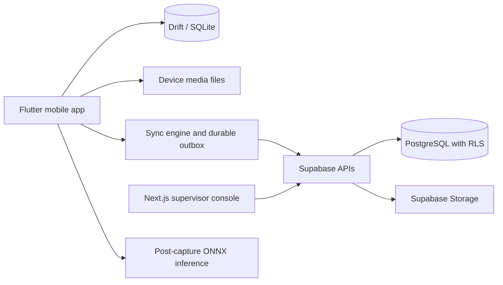

# FieldLens architecture

This document records the intended architecture and distinguishes implemented local behavior from later targets. Local foundation and draft behavior are verified; the full product remains in development.

## System boundaries



The mobile app is the technician workflow, the planned console is the supervisor workflow, and Supabase is the planned authentication, authorization, relational data, and remote media service. There is no console or Supabase implementation. UI components use repository/provider boundaries over local state rather than selecting local versus remote persistence.

## Implemented local foundation and inspection drafts

The mobile app opens Drift/SQLite in the application support directory and seeds two demo sites with the five plan assets and assignments: control cabinet, conveyor motor, PCB/controller, compressor, and network cabinet. This demo data is local and is not scoped by an authenticated user or organization. Assigned work orders are queried reactively and rendered by the Riverpod-backed dashboard. Starting an assigned work order updates local status and inserts a UUID-keyed outbox operation in one SQLite transaction. The dashboard shows locally queued changes. There is no synchronization transport, so operations remain on-device.

Inspection templates are typed, schema-driven records. The Factory Demo template supports the planned field families and validates schema data and answers. Beginning an inspection creates a durable local draft with a JSON snapshot of its template. That snapshot is immutable for the draft's lifetime, so later catalog changes do not rewrite an in-progress inspection. Answers have stable UUID record IDs, and each answer save commits the answer and a replayable draft snapshot outbox operation locally. SQLite schema version 2 adds template, draft, and answer tables and uses a data-preserving Drift table migration to give existing outbox records monotonic local sequences. Operation UUIDs remain unique transport identities; timestamps do not determine replay order. The inspection UI supports editing and reviewing draft validation; it does not submit or finalize an inspection. Photo and signature fields are placeholders; capture and attachment handling are not implemented.

## Local asset identification

The dashboard opens an asset-identification screen with manual serial search and QR scan. Serial search is exact after trimming whitespace and comparing without case sensitivity. It returns every match, ordered by site and asset tag, so duplicate serials across sites remain visible and the technician selects the correct asset. It does not choose an arbitrary match.

QR resolution is local and accepts only a `FIELDLENS://ASSET/<identifier>` URI. Scheme and host comparison ignores case; the identifier remains case-sensitive. User information, ports, query strings, fragments, extra path segments, percent-encoded identifiers, and malformed URIs are rejected before URI normalization can create an alias. Duplicate stored codes after scheme/host normalization fail with an explicit ambiguity error; no asset is selected arbitrarily. A valid but unknown code receives a distinct no-local-match result. The `mobile_scanner` integration uses its bundled on-device ML Kit barcode model, so scanning does not require network access. When the camera cannot start, the scanner offers manual QR payload entry; serial search is also available.

Repository and widget tests cover matching, ambiguity, strict QR parsing, local resolution, and navigation from an identified asset to assigned work. Physical-camera acceptance has not run because no device is attached; widget tests inject scan results and do not validate native camera behavior.

The recorded pre-asset-identification baseline passed formatting, analysis, all 38 then-existing Flutter tests, frozen schema comparison, and Android debug packaging. Draft persistence and migrations passed independent review. Asset-identification tests were added after that baseline; refreshed aggregate results are pending. Physical-camera and server end-to-end validation remain unrun.

## Mobile local-first write and read paths

Drift/SQLite is the mobile application's authoritative state for its UI, not a disposable cache. Work orders and inspection drafts observe repository streams backed by local tables. Starting work commits its status update and outbox operation in one SQLite transaction. Saving an inspection answer similarly writes locally with its replayable outbox snapshot in one transaction, so the UI reflects saved state without waiting for a network.

```text
UI action -> repository -> SQLite transaction
                         ├─ domain record / answer update
                         └─ outbox operation with UUID
UI observation <- local repository stream
```

Repository APIs hide storage and synchronization details. They must not expose an `if online then remote else local` decision to the UI. No remote repository or sync engine exists yet.

## Identity, media, and inspection data

Records that may originate offline receive stable UUIDs on-device. Server persistence must accept those client-generated identifiers so a later upload does not change local references.

Photo and other binary evidence is intended for the device filesystem. Drift will store references and metadata; image bytes do not belong in SQLite. Media capture, file lifecycle, and upload handling are not implemented.

The current inspection form is driven by a versioned schema and validates supported field families: boolean, pass/fail/N/A, single and multiple choice, numeric, text, photo, QR/serial, and signature. Photo and signature controls are placeholders only. A draft stores its template snapshot and answers in Drift so edits survive application process termination. Submission and finalized inspections remain future work.

## Synchronization and conflict handling

The outbox is the durable record of local mutations awaiting remote acknowledgement. Each operation has a unique operation UUID, entity identity, payload, creation metadata, and retry state. The sync engine should upload dependencies and media before dependent mutations, use idempotent server operations, classify retryable and permanent errors, apply exponential backoff, and recover safely after process termination.

Synchronization can be triggered on application startup, resume, restored connectivity, and an explicit user request. Scheduled background work can help but cannot be the sole trigger or reliability mechanism. Sync status and actionable failures are part of the product UI.

After pushing local work, the engine pulls remote changes and merges them into local state. Mutable synchronized records carry server revision metadata. Writes use expected-revision semantics where appropriate; a stale revision becomes a visible conflict that can be resolved deliberately instead of silently overwriting meaningful edits.

The current outbox records local work-order status and inspection-draft snapshots. It is not connected to a server, so no queued operation is synchronized yet.

## Backend security boundary

Supabase Auth identifies users. PostgreSQL Row Level Security and server-side operations enforce organization boundaries and role capabilities. Hiding a control in the console is not authorization. Storage policies also need to bind objects to the right organization and inspection permissions. Migrations, policies, and sync APIs must preserve these rules for direct and application-mediated access. The local demo data currently has no authenticated account or organization scoping.

## On-device inference

The initial AI flow runs after image capture: resize and normalize the image, execute the packaged ONNX model, post-process detections, and show results for technician review. Do not make live camera inference a prerequisite. Persist model name/version/hash, inference duration, device context, raw prediction and confidence, and technician verdict separately. Technician confirmation or correction must not overwrite the original prediction. No image capture or inference code exists yet.

## Intended implementation sequence

The plan sequences work as follows: (1) local foundation, (2) offline assets and work orders, (3) schema-driven inspections, (4) offline asset identification, (5) evidence, (6) authentication and cloud backend, (7) synchronization, (8) conflict and recovery behavior, (9) on-device AI, (10) supervisor console, (11) operational features, and (12) production/portfolio readiness. Each phase requires its own documented acceptance checks. The detailed scope and acceptance criteria are in [the project plan](fieldlens_end_to_end_plan.md).

## Current implementation state

Implemented locally: Flutter/Riverpod/Drift foundation, demo sites/assets/assignments, reactive work-order list, atomic local work-order/outbox writes, typed inspection schema and validation, data-preserving v1-to-v2 database migration, immutable template snapshots, durable local drafts, UUID answer records/outbox snapshots, exact local serial search, strict local QR resolution, and scan/manual fallback UI. Local foundation and draft behavior are verified. Asset-identification code has repository/widget coverage, while physical-camera acceptance remains unrun. The full product remains in development. Not implemented: authenticated account scoping, evidence/signature capture, inspection submission, backend transport, Supabase Auth/PostgreSQL/Storage/RLS, conflict handling, ONNX inference, supervisor console, and operational/release features. See [progress.md](progress.md).
